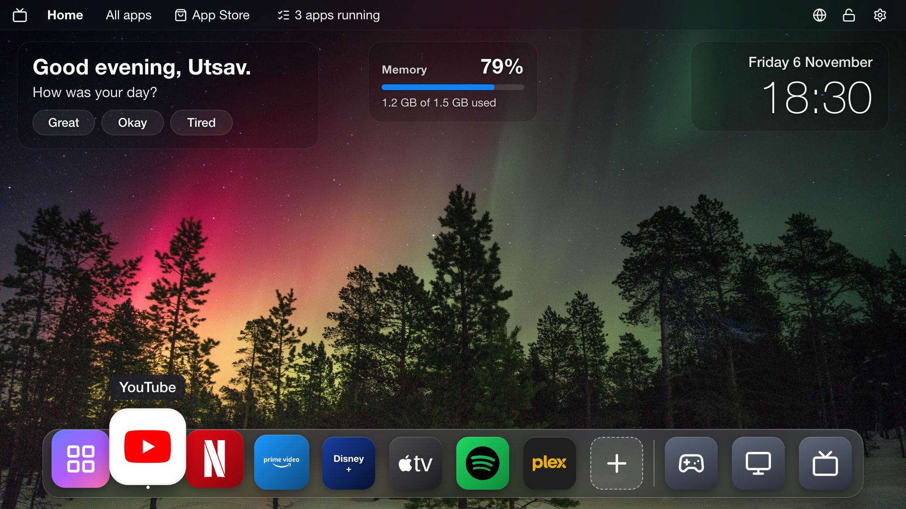
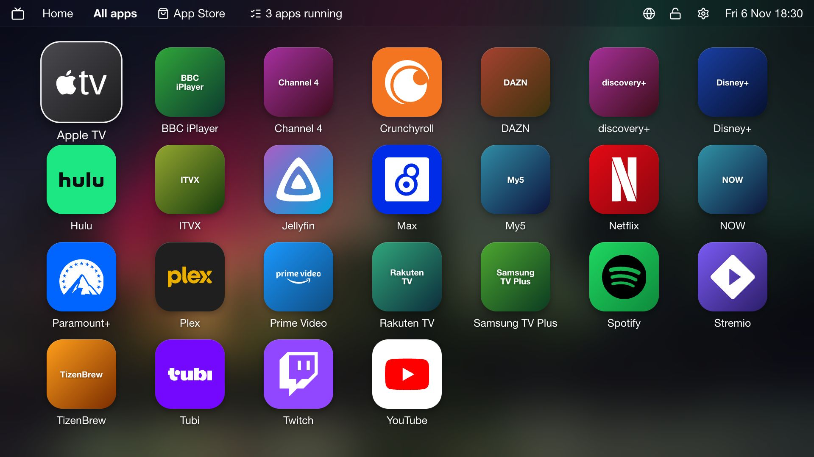
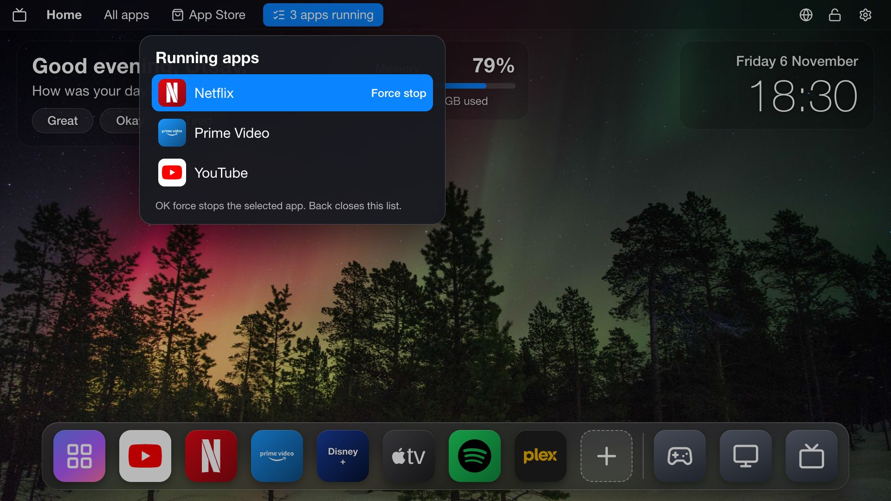
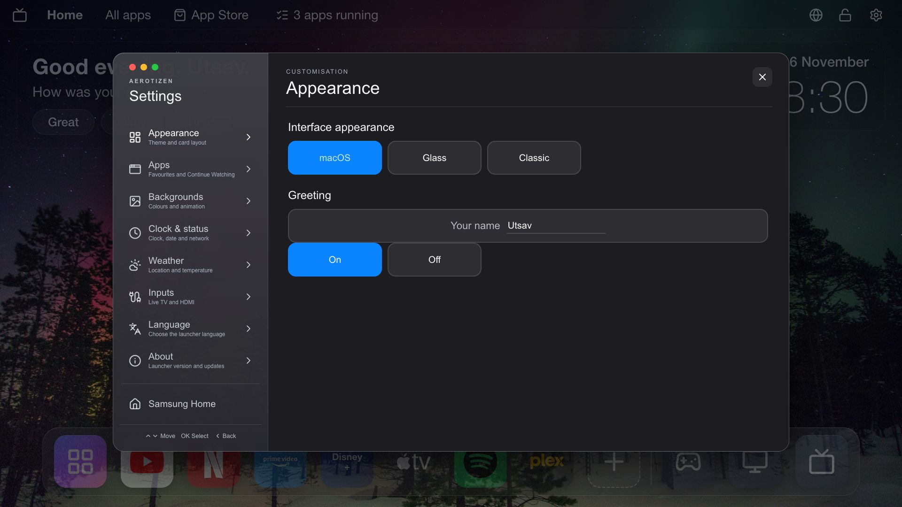
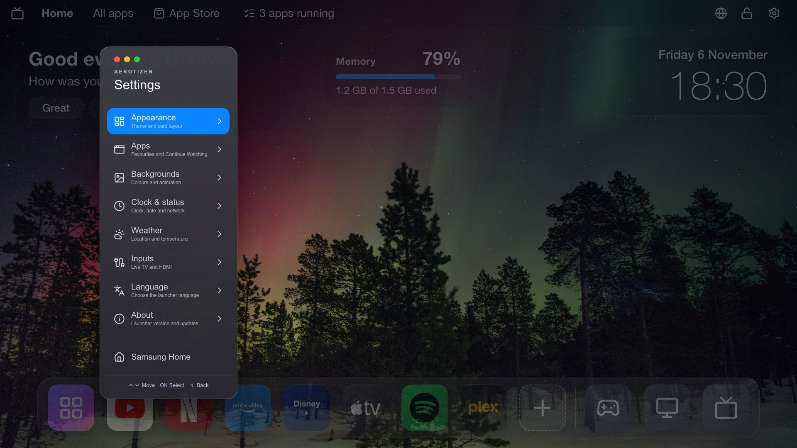
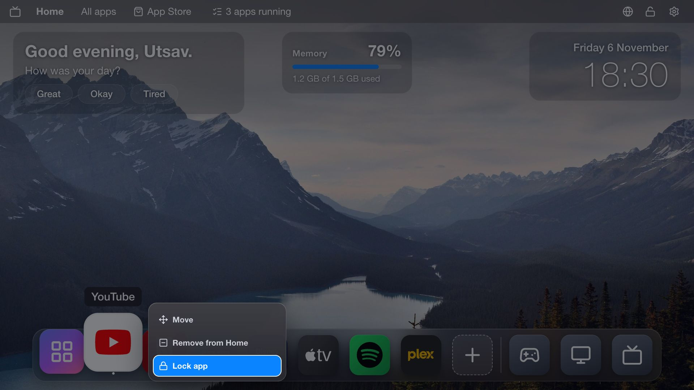
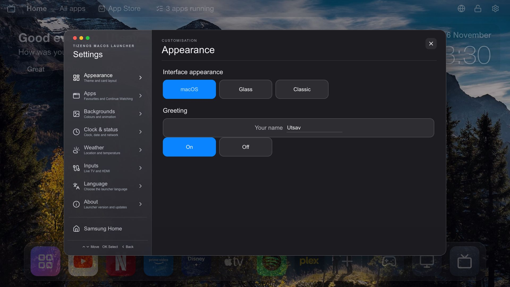

# TizenOS macOS Launcher

A macOS-style home screen for Samsung TVs running Tizen 9. It replaces Samsung's ad-filled Home
with a menu bar, a Dock, a Launchpad, desktop widgets and true 4K wallpapers, and adds a task
manager, app locks and a TV passcode. No ads, no tracking, no autoplay.

Made by Utsav ([umistry](https://github.com/umistry)). Built on [AeroTizen](https://github.com/helalaou/AeroTizen) by Hamza El Alaoui (MIT).



Read the [case study](docs/case-study/README.md) for how it was built and what was measured on a
real TV.

## What you get

- **A Mac-like desktop:** a menu bar, a Dock that magnifies as you move, and a Launchpad with
  every installed app. Add or remove Dock apps with the **+** button.
- **Widgets:** a greeting that changes with the time of day and asks how you are, live memory
  use, and the date and time.
- **True 4K wallpapers:** 15 landscape photos, a new one each time you come back to Home. The TV
  draws apps at 1920x1080, so each photo also ships as a short HEVC clip, which plays on the TV's
  4K video layer.
- **Task manager:** see which apps are running and force stop them from the menu bar.
- **App Store** shortcut in the menu bar. Newly installed apps get their proper icons
  automatically.
- **App locks:** hold OK on any app and choose **Lock app**. It then asks for your passcode.
- **TV passcode:** lock the TV now, or have it ask every time it's turned on. Settings asks for
  the passcode too.
- **Replaces Samsung Home:** the Home button and power-on open this launcher, with a one-command
  restore.
- English, Russian and Arabic.

| | |
| --- | --- |
|  |  |
|  |  |
|  |  |

## Will it work on my TV?

It was built and tested on a 65" Samsung **UA65CU7700** (2023 Crystal UHD) running **Tizen 9.0**.
Other Samsung TVs on Tizen 9 should work the same way. The Home replacement is marked
experimental upstream; it has also been reported working on a 2024 Frame and an S90C.

Samsung TVs from 2023 onwards that received the Tizen 9 update, and 2024–2025 models, are the
likely fit. The install guide shows how to check your TV's Tizen version. On older Tizen versions
the original [AeroTizen launcher](https://github.com/helalaou/AeroTizen) may suit it better.

## Install

You need a computer on the same Wi-Fi as the TV and a free Samsung account. It takes about
20 minutes the first time. Download the latest release from [Releases](https://github.com/umistry/Clean-TV-Launcher/releases), then follow the
step-by-step [install guide](INSTALL.md).

In short:

```bash
./aerotizen --tv TV_IP certs
./aerotizen --tv TV_IP install ./tizenos-macos-launcher
./aerotizen --tv TV_IP home backup
./aerotizen --tv TV_IP home apply --yes --boot
```

> **Never run `aerotizen update launcher`.** It installs the original AeroTizen launcher over this
> one. To update, download the new release and run `install` again; your settings are kept.

## Good to know

- **The lock is a deterrent, not real security.** Samsung's own overlays (volume, quick settings),
  voice commands and phone casting can still get through, and an app can show for a second or two
  before the launcher takes the screen back. The app lock only covers apps opened from the
  launcher, not the remote's Netflix or Prime Video buttons.
- **Some apps can't be force stopped.** Samsung keeps Netflix and Apple TV preloaded so they open
  faster, and only Samsung's partner apps may close them.
- **Preinstalled apps can't be removed from a computer on Tizen 9.** Delete them on the TV under
  **Apps → Settings**. The [install guide](INSTALL.md#7-make-the-tv-faster) lists which ones are
  worth deleting.
- **The first power-on after setup can show a black screen** for up to about 30 seconds.

## Build from source

Node.js 20.19 or newer:

```bash
npm ci
npm run build            # writes dist/launcher
npm test                 # Node tests
npx playwright test      # browser tests
npm run dev              # preview at http://localhost:8019/?demo=macos
```

Install your own build with `./aerotizen --tv TV_IP install ./dist/launcher`. Coding conventions
are in [CONTRIBUTING.md](CONTRIBUTING.md) and [launcher/AGENTS.md](launcher/AGENTS.md).

The AeroTizen command-line tool, Developer Mode details, diagnostics and the optional root
features are documented in the [original AeroTizen README](README-AeroTizen.md).

## Credits and license

- [AeroTizen](https://github.com/helalaou/AeroTizen) by Hamza El Alaoui: the launcher this is
  built on, the background watcher, Native Home and the command-line tool.
- Wallpaper photos from [Unsplash](https://unsplash.com), served through
  [Lorem Picsum](https://picsum.photos). Each photographer is credited in
  [CREDITS.md](launcher/assets/photos/CREDITS.md).
- Icons from [Lucide](https://lucide.dev), fallback app logos from
  [Simple Icons](https://simpleicons.org). App artwork is read from Samsung's cache on each TV.
- Not affiliated with Samsung or Apple. Samsung, Tizen, macOS and app names are trademarks of
  their owners.

MIT License. See [LICENSE](LICENSE).
