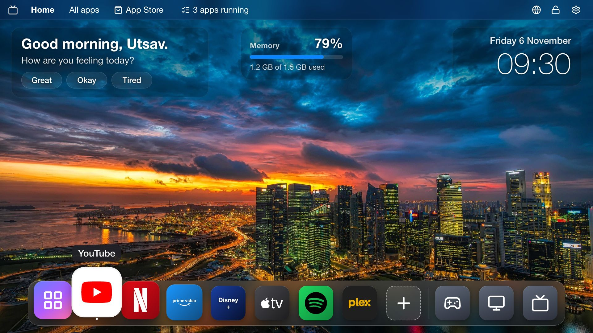
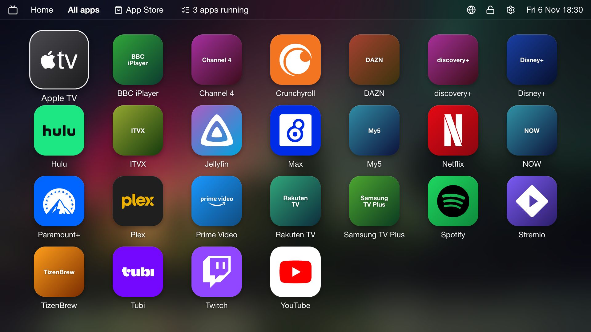
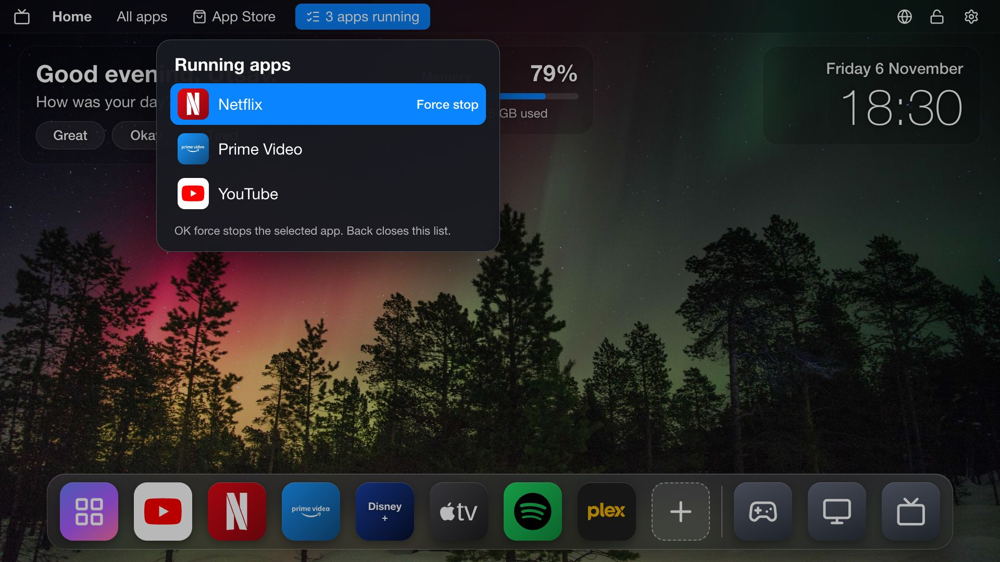
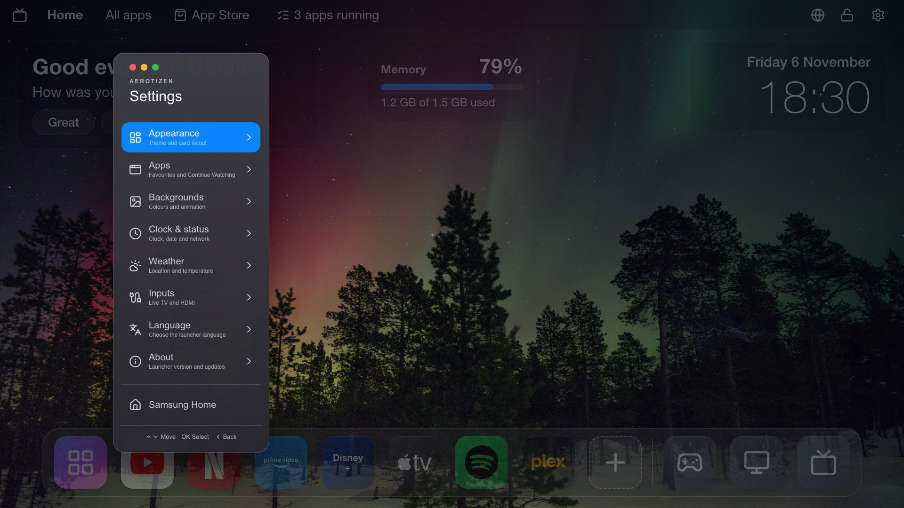
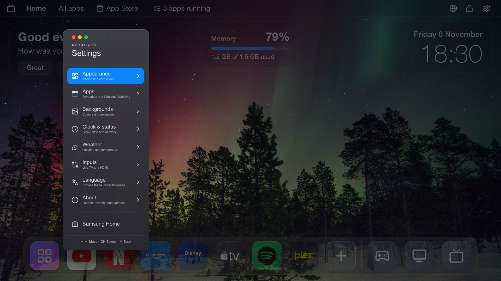
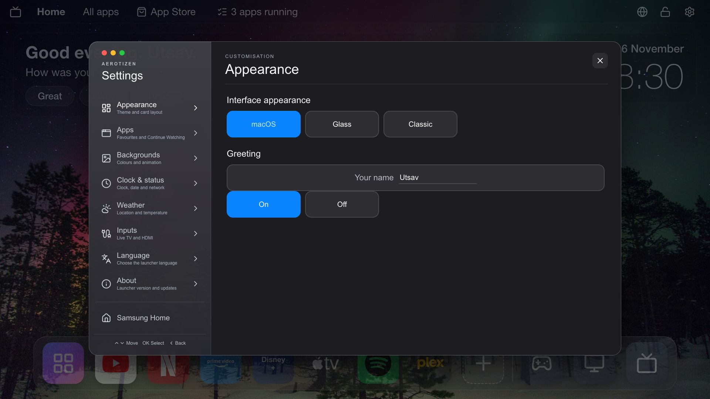
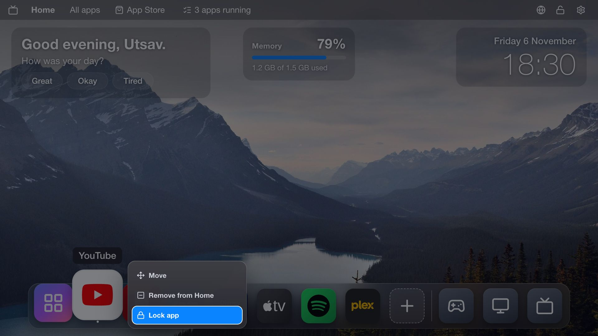
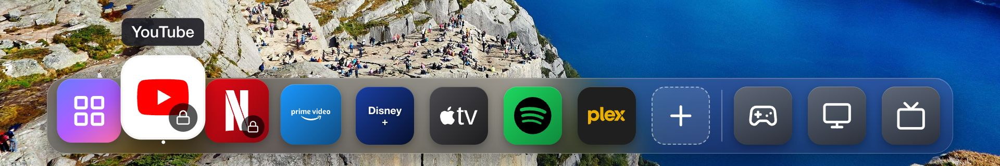
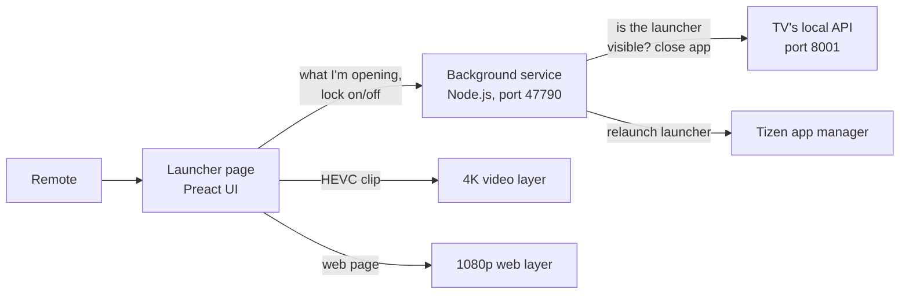

# Case study: a macOS-style home screen for a 2023 Samsung TV

**Utsav ([umistry](https://github.com/umistry)) · November 2026**

A two-day project to replace the ad-filled Home screen of a Samsung Tizen TV with a clean,
macOS-style launcher, make the TV faster, and add features Samsung doesn't offer: true 4K
wallpapers, a task manager, app locks and a TV passcode.

## At a glance

| | |
| --- | --- |
| TV | Samsung UA65CU7700 (65", 2023 Crystal UHD), sold in India |
| Software | Tizen 9.0, Chromium 120 web engine, 32-bit ARM |
| Memory | 1.5 GB in total, about 370 MB free when we started |
| Starting point | [AeroTizen](https://github.com/helalaou/AeroTizen), an open-source launcher (MIT) |
| Built with | Preact and TypeScript for the screens, plain JavaScript for older TV APIs, a small Node.js background service, Playwright tests |
| Built by | Utsav, with Claude Code as a pair programmer |

## The problem

Samsung's Home screen on this TV is a row of sponsored tiles, autoplaying previews and
"recommended" apps. The TV also shipped with 24 preloaded games and several Samsung services that
run in the background all the time. With only 1.5 GB of memory, it felt slow: apps took a while to
open and the menus stuttered.

The goals were:

1. A clean home screen that looks and works like macOS: a menu bar, a Dock and a Launchpad.
2. A home screen that feels personal: a greeting by name, a different photo every time.
3. Remove the bloatware and make the TV faster.
4. Control: see and stop running apps, lock apps, and lock the whole TV with a passcode.
5. Make the old Home screen go away for good.

## Constraints that shaped everything

- **Samsung doesn't let you replace the launcher officially.** Third-party apps install through
  Developer Mode and must be signed with certificates tied to one TV.
- **Apps are drawn at 1920x1080**, even on a 4K panel. Only video plays at full 4K.
- **The certificate is "public" level.** Partner-only abilities, such as closing other apps or
  removing preinstalled ones, are off limits.
- **Hidden web apps are frozen.** Once another app is on screen, the launcher's own code stops
  running, so anything that must keep watching has to live in a background service.
- **Little memory.** Every visual effect had to be measured on the TV, not just in a desktop
  browser.

## What was built

- **Desktop and Dock.** A translucent menu bar, a Dock that magnifies around the focused icon, and
  a Launchpad grid of every app. The **+** button in the Dock opens the Launchpad with ticks, so
  apps can be added or removed with OK.
- **Widgets.** A greeting that changes with the time of day ("Good evening, Utsav.") and asks a
  question with three quick replies. When you come back from an app, it says "Welcome back, Utsav.
  How was YouTube?". A live memory widget and a large clock sit beside it. The centre stays empty
  on purpose.
- **Photos.** 15 landscape photos, a new one each time you return to Home, in a shuffled order
  that shows every photo before repeating.
- **Task manager.** "3 apps running" in the menu bar opens a list with a force stop button.
- **App Store and icons.** A menu bar shortcut to Samsung's store. Newly installed apps find their
  own artwork.
- **Locks.** A 4-digit passcode, a lock screen at power-on, per-app locks, and Settings behind the
  passcode.

| | |
| --- | --- |
|  |  |
|  |  |
|  |  |

## How it fits together

The launcher page draws everything you see. The background service keeps running while other
apps are on screen. It brings the launcher back when you press Home, keeps it in front while the
TV is locked, and closes apps for the task manager through the TV's own local API.

## The hard problems

### 1. Getting real 4K wallpapers

The first photos were 4K JPEGs, but the TV scaled them down to 1920x1080 like everything else on
the web layer. Video, though, plays on a separate layer at the panel's full resolution.

So each photo also ships as a one-second HEVC clip of the same still image, made with a small
Swift tool using Apple's video encoder. The launcher shows the 1080p photo at once, plays the clip
on the video layer behind the page, pauses on a sharp frame and fades the photo away. The result
is 3840x2160 on screen. The clip starts in 0.6 to 1 second.

Getting there took detours. Samsung's own player (AVPlay) failed with decode errors, which turned
out to be the test server not supporting partial downloads; a clip packaged inside the app worked
first time with a plain `<video>` element. The video layer also needs care: the clip is released
the moment you open an app or switch input, so Netflix or HDMI gets the decoder, and it comes back
when you return. Screenshots taken through the debugger can't see the video layer at all, so only
your eyes on the TV can judge the result.

### 2. YouTube that opened for a second and closed

After a force stop, YouTube would open, then the launcher jumped back in front about a second
later. The TV was reporting an error for the launch even though YouTube had opened. The launcher
believed the error, told the background service it was back, and the service pulled the launcher
over YouTube.

The fix waits 4 seconds after an error and only treats the launch as failed if the launcher still
has the screen and focus.

### 3. The old Home screen kept coming back

By default the background service watches for the Home button and reopens the launcher. But it
has to stand aside while YouTube or Live TV is playing, so Home from those still opened Samsung's
Home. Power-on also showed Samsung's Home for about 2 seconds first.

AeroTizen's "Native Home" mode changes the TV's own settings so the Home button and power-on point
at the launcher. It's one command (`home apply --yes --boot`) with a saved backup and a one-command
restore. After applying it and unplugging the TV for a minute, the Home button worked from every
app and the TV started straight into the launcher.

### 4. Knowing when you're back

The greeting and photo change "when you come back", but a TV doesn't say so reliably. Sometimes
the page is hidden, sometimes it only loses focus, and in standby its timers simply stop. The
launcher combines three signals: visibility changes, focus changes, and a heartbeat that notices
when 15 seconds have silently passed. All three feed the same "away" and "back" events.

### 5. Every effect costs frames

Frosted-glass blur behind the widgets looked right in a desktop browser but cut the Dock from 43
to 27 frames per second on the TV, so the widgets became plain tints. Later, the widgets were
softened further: almost transparent panels with a gentle shade behind the whole row, so the text
stays readable without heavy boxes.

### 6. A passcode lock on a TV

The lock screen itself is simple. Making it hold was not:

- **Power-on.** A launcher frozen in standby doesn't know the TV was off. The background service
  notices a gap in its own heartbeat (8 seconds or more) or the TV reporting it has powered back
  on, and turns the lock on.
- **Staying in front.** While locked, the service checks every 2 seconds whether the launcher is
  visible and the TV is on, and reopens it if Home, Source or another app covered it. It never
  launches anything while the TV is off, so it can't wake the screen.
- **Storing the code.** The passcode is kept only as a salted SHA-256 hash. The browser's built-in
  crypto isn't available to a TV app's page, so the hash is a small pure-JavaScript
  implementation, tested against the standard test values. Five wrong tries pause the keypad for
  30 seconds.

It's honest to call this a strong deterrent rather than real security: Samsung's own volume and
quick-settings overlays, voice and phone casting can still get through briefly.

### 7. Force stop, and the apps Samsung won't let go

Force stop asks the TV's local API to close an app, which works for apps like YouTube. Netflix and
Apple TV kept "running". The TV keeps them preloaded so they open faster, and in that state its
API reports them as not running, so the close request does nothing. The other route needs a
partner-level certificate. The launcher now says exactly that instead of a vague error.

### 8. Removing bloatware

The plan was to remove preloaded apps from the computer. On Tizen 9 the developer connection
refuses to uninstall any store or preloaded app, so the deletions had to be done on the TV. 7 of
the 24 preloaded games kept a background service running all the time, even though nobody had
opened them. Deleting all 24 removed those services.

### 9. Icons that didn't load

JioHotstar, SonyLIV, ZEE5 and two others showed their name on a coloured tile instead of an icon.
Samsung keeps each app's artwork in a folder named after its store ID, and the launcher only knew
the IDs of apps in its catalogue. These five were added after checking their IDs on the TV. The
launcher now also matches unknown apps to their folders by asking the TV's local API which app
each folder belongs to, so apps installed later get their icons automatically.

## Results

Measured on the TV before and after, with no app open:

| | Before | After |
| --- | --- | --- |
| Free memory | 371 MB | 575–608 MB |
| Background processes | 60 | 55 |
| Dock smoothness | 42 fps, slowest frames 83 ms | 60 fps, slowest frames 17 ms |
| Wallpaper resolution | 1920x1080 | 3840x2160 |
| Preloaded games | 24 | 0 |
| Home button from YouTube or Live TV | Samsung's Home | This launcher |
| Ads and viewing tracking | On | Off |

The "after" figures were taken after a restart, so part of the gain comes from a fresh start. The
memory figure held at 575 MB in a second measurement later the same day.

The project ships with 287 Node tests and 166 browser tests. They cover the lock flow, the
wallpaper clip, the YouTube launch, the background service's lock guard and the passcode hash.

## What didn't make it

- **Animated characters in the background.** An early experiment with 3D-style animated
  characters reacting to the TV was built and tested, then removed: on the real TV they didn't
  look good enough.
- **Turning off Samsung's settings from the computer.** Privacy and start-up settings are Samsung's
  system settings and were changed by hand on the TV.
- **Closing preloaded apps.** Not possible without a partner certificate or root.

## Lessons

- **Test on the real device early.** The desktop preview hid the blur cost, the video layer, the
  frozen timers and the YouTube error. Each was found on the TV.
- **Don't trust a single signal.** The launch error, the "running" status and focus each lied
  once. The fixes all cross-check two sources before acting.
- **Measure before and after.** Memory and frame rate numbers turned "it feels faster" into
  something checkable.
- **Make everything reversible.** Native Home has a saved backup and a restore command, the
  passcode can be reset from a computer, and every removal was done by the owner on the TV.

## Credits

Built on [AeroTizen](https://github.com/helalaou/AeroTizen) by Hamza El Alaoui, which provided the
launcher foundation, the background watcher, Native Home and the command-line tool. Wallpaper
photos are from Unsplash; each photographer is credited in
[CREDITS.md](../../launcher/assets/photos/CREDITS.md).
